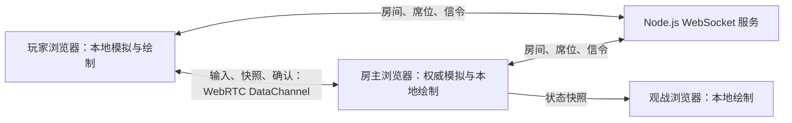

# 对等联机试验平台

首款：大厅中的「泡泡堂 · 对等联机版」，游戏 ID 为 `3881-native`。当前入口支持 2～4 名真人自由对战，无电脑补位，支持键盘和触屏按钮。原有 Flash 游戏继续使用原入口。旧人机逻辑仍留在模拟层供历史测试使用，不会由当前页面启用。

2026-10-14 已部署到 `https://223.109.141.251/`：真实 IP 证书与 HTTPS/WSS 检查通过，外网双浏览器通过 WSS 的移动同步通过。TURN 外部端口当前超时，尚未通过真实 TURN 数据通道验收；两地真实设备延迟也仍待验证。最新现场状态见 `DEPLOYMENT_STATUS.md`。

2026-10-20 的四人联机与准备机制、特殊武器优先攻击、行走动画比例和音效控制已发布到上述公网地址；公网浏览器验证了两人及四人开局、攻击优先级与音效设置刷新保留，详细版本见 `DEPLOYMENT_STATUS.md`。

## 当前玩法

- 房主可选择「经典棋盘／交错回廊／开阔广场」三张程序生成地图，以及开局武器；默认从地图拾取。
- 2～4 位玩家可在四个席位中任选座位。至少两人入座且所有已入座玩家准备后自动开局；空位不参战。换座、离座会取消所有人的准备并重置当前回合；下一局需要重新准备。
- 普通道具共六类：炸弹糖、威力药、飞鞋、盾牌、生命、推弹手套。推弹会使炸弹滑行，遇障碍引爆；生命最多五格。
- 六种特殊武器见下表。拾取会替换现有库存；冰箭一发，其余两发。原作的 65% 道具掉落率、普通道具权重与特殊道具占比沿用，特殊武器在六类中随机选择。
- WASD／方向键移动，空格／回车为攻击键；持有特殊武器时先消耗武器弹药，之后才放普通炸弹。E／Shift 也可作为同一攻击键。移动途中按下的特殊武器会保留至下一格施放。
- 画面下方可开关音效并调整音量；设置保存在当前浏览器。关闭音效会立即停止正在播放的效果音。行走动画按角色可见区域绘制，站立与移动时保持一致尺寸。
- 三分钟限时，最后存活者获胜，所有人同时出局或到时多人存活则平局。刷新房主会回到等待状态。

| 武器 | 行为 |
| --- | --- |
| 火箭 | 沿朝向加速，命中角色、炸弹或障碍时爆炸 |
| 地雷 | 放在脚下，对手靠近或火焰触发；主人可踩过 |
| 手榴弹 | 投到前方两格，越过中间障碍，落点与相邻四格爆炸 |
| 汽弹 | 地面陷阱，使触发者减速 600 tick（约 17 秒） |
| 冰箭 | 每四步延伸一格，最多三格，短暂阻路并冻结角色约 300 tick；火焰能破冰 |
| 火焰箭 | 每四步延伸一格，最多三格，可烧穿可破坏障碍并引爆炸弹 |

角色行走和爆炸／冰火效果使用从原 SWF 导出的动画帧；生成脚本是 `scripts/import-bomb-assets.py`。

地图上的六类普通道具和六种特殊武器拾取图标现使用原 SWF `DefineSprite_327_tool` 前 12 帧；装备状态、触屏武器按钮和玩法说明也显示同一套图标。图标由素材脚本生成到 `public/native/assets/item-*.png`。未出现的道具仍须按玩法炸开障碍后掉落，或通过房主的「开局武器」选择验证武器状态。

## 启动

```powershell
cd 'D:\github repo\ArcadeOnline'
npm ci
npm run build:native
npm start
```

打开 `http://localhost:8000/`，或直接打开：

`http://localhost:8000/native-room.html?game=3881-native&room=demo`

2～4 台设备使用同一服务地址和房间名；同机测试可使用独立浏览器窗口。每个窗口入座一个席位并点击「准备」。局域网邀请应使用房主电脑的局域网 IP，不能把 `localhost` 链接发给另一台设备。

浏览器包 `public/native/bomb.js` 已生成。修改 TypeScript 后先重新构建；`scripts/native-build.json` 记录源码和浏览器包的哈希，部署会拒绝过期构建。`npm run package:linux` 完成类型检查、构建与打包，产出可上传 Linux 的压缩包，详见 [LINUX_DEPLOY.md](LINUX_DEPLOY.md)。

## 实际架构



房主是星形连接的权威端，不是每位玩家之间都建立连接。服务端不运行游戏物理，也不接收新游戏的视频帧。无法建立 WebRTC 连接时，WebSocket 转发相同的输入/快照，继续本地渲染和预测。界面显示「对等连接」或「中继连接」；配置 TURN 后，WebRTC 也可能经过 TURN 转发，该标签不保证物理网络路径为直连。

| 文件 | 职责 |
| --- | --- |
| `src/native/core.ts` | 可序列化游戏状态、种子随机数、35Hz 逻辑、校正后重演 |
| `src/native/network.ts` | 通用房间连接、WebRTC 信令、DataChannel、心跳和中继回退 |
| `src/native/main.ts` | 游戏与房间适配、席位检查、输入历史、快照应用、界面 |
| `src/native/view.ts` | 本地 Canvas 绘制、素材及权威事件音效 |
| `server.js` | 现有房间与席位管理；新增 native 中继和临时 TURN 配置接口 |
| `public/games.json` | 用 `runtime: "native"` 注册新入口 |

## 延迟与一致性机制

- 两端使用同一份模拟代码。房主固定 35Hz，客户端在下一个本地模拟步处理自己的按键。
- 远端每个模拟步发送完整当前方向、递增序号和攻击计数，避免只发送 keydown/keyup 时丢一次包就卡键。旧协议中的独立特殊武器计数字段仍保留供早期模式使用，当前真人联机只使用统一攻击计数。
- DataChannel 使用无序、不重传模式；输入序号、局号和状态 tick 拒绝过期消息。持续快照与完整输入负责恢复丢失的数据。
- 房主约每三步发送完整快照，包含地图、四个角色槽位及参战席位、炸弹、特殊武器、冰火效果、道具、随机数状态和已处理输入序号。当前状态格式为 version 2；更新版本时双方需刷新页面。
- 客户端收到快照，恢复权威状态，重演未确认输入；待确认历史上限为两秒。长期没有状态时停止继续预测并显示连接恢复提示。
- 房主只根据发送者实际席位接受输入。客户端不上传自己判定的位置、道具或胜负。服务器中继也检查房间、席位和消息方向。
- 600ms 没收到某玩家新输入时，房主清除其方向状态。失焦、触摸取消和离座也释放输入。
- 房主退出或刷新时安全开始一个新的等待回合；首轮不做无缝中局迁移。远端刷新可恢复同一会话和席位，并继续当前回合。
- 运行模拟不调用系统时间或非种子随机数；局号生成和网络诊断在模拟外使用时间。

预测能缩短本地操作反馈，不能让网络中的权威确认瞬间到达。这里仍然是房主权威，尚未实现竞技级反作弊或消除所有房主优势。网络分歧会触发校正；首轮没有视觉校正平滑或复杂交互的专门延迟补偿。

## 验证

```powershell
npm run typecheck
npm run build:native
npm run test:native
npm run test:native:e2e
npm run test:deploy
npm test
```

- 模拟与协议测试：移动、连锁、六种武器、道具、减速／冻结恢复、推弹、2～4 人参战与空席、快照校正、非法输入、三四号席位和准备状态权限。
- Chromium 四浏览器测试：四人分别入座、未全员准备时等待、全员准备自动开局、P3/P4 独立输入、离座取消准备、三人无电脑开局和移动视口。
- 旧平台冒烟测试继续通过。

此前双人版的本机 headless Chromium 人工延迟测试测到约 202–220ms 网络往返、31–75ms 本地移动反馈。当前四人测试验证了功能流程，尚未重新测量延迟或公网四设备体验。最新本机结果见 `artifacts/native-e2e/results.json`，手机视口截图在同目录。

这些是同机浏览器下的功能验证，不是公网、跨设备、真实链路拥塞或物理按键到屏幕的基准；采样量也不足以声明 P95。此前双人版做过人工延迟和随机丢包测试，四人版尚需重新验证。真实公网验收仍需覆盖两地设备、Wi-Fi、不同浏览器和 TURN 路径。

连接诊断可展开查看 RTT、本地输入到绘制、校正次数、状态新鲜度和收发量。测试页面使用 `debug=1` 时暴露 `window.__nativeTest` 检查接口；正常邀请链接会移除该参数。

## 公网部署和 TURN

Node.js 继续负责网页、房间、信令以及备用中继。公网建议用 Caddy 或 Nginx 提供 HTTPS/WSS。例如 Caddy 的站点配置：

```caddyfile
arcade.example.com {
    reverse_proxy 127.0.0.1:8000
}
```

为提高无法直连的网络中的 WebRTC 成功率，可部署 coturn。应用已支持时间有限的 TURN REST 凭据，设置环境变量即可：

```text
TURN_URLS=turn:turn.example.com:3478?transport=udp,turn:turn.example.com:3478?transport=tcp
TURN_SECRET=<与 coturn static-auth-secret 相同的值>
```

coturn 使用 `use-auth-secret`、匹配的 `static-auth-secret` 和 `realm`。按实际服务配置开放监听与中继端口；如果使用 `turns:`，还需要 TURN 服务本身配置 TLS 证书。systemd 部署时把变量加入 `/etc/arcade-online.env` 并重启应用。

`/rtc-config` 返回 STUN 地址和一小时有效的 TURN 用户名/凭据；用户名包含随机标识以分开配额，浏览器每二十分钟刷新配置，共享密钥只留在服务器。`deploy/public-linux.sh` 提供 Ubuntu/Debian 的应用、Caddy、coturn 安装：仅有公网 IP 时使用 Let's Encrypt 短期 IP 证书和自动续期；也支持域名。已在实际 Ubuntu 26.04.1 主机完成安装、证书签发和 HTTPS/WSS 验证；TURN 外网端口与真实续期仍待验收。安装、端口、NAT 配置及探测命令见 [LINUX_DEPLOY.md](LINUX_DEPLOY.md)。

首轮不需要数据库或 Redis。未来增加其他重建游戏时，复用 `Network`，传入新的 game ID、实现独立模拟/渲染适配并注册目录。多进程扩展时再处理房间路由及共享会话；当前部署为单 Node.js 进程。

## 与原作的差异和后续边界

这是玩法重建，不是完整原作移植。三张地图和电脑策略为新实现，原作全关卡推进、计分成长、人物选择、全部场景和过场尚未复刻；普通爆炸目前即时展开射线，原作按帧传播；手榴弹用 18 tick 投掷动画，生命道具作为当局额外承伤而不是原作跨关生命。动画只迁移实际用到的部分。羽毛球仍保留原 Flash 入口。

房主权威及其公平性边界不变；没有无缝中局房主迁移或竞技级反作弊。Linux 上的网页服务不代替房主运行游戏。反编译证据、素材来源及羽毛球的改造难点见 [SWF_RECONSTRUCTION.md](SWF_RECONSTRUCTION.md)。
